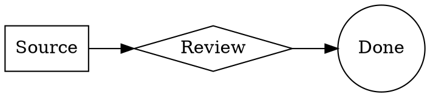

# Bounded Graphviz diagrams

Issue #73 adds `graphviz` and `dot` fences. This is a small DOT subset, not general Graphviz compatibility. Complete top-level column-zero fences render only after explicit operator configuration. Original Markdown remains authoritative; click/tap the diagram or use its keyboard source control to edit. Moving the caret away renders again. Pointer drags/touch scrolling do not enter source. Raw mode, no-JS pages, unsupported input and failed/over-budget diagrams retain source. Rendering never saves or reformats notes.

Accepted: graph/digraph with optional simple name; ASCII node identifiers of 1–32 characters; directed or undirected edges/chains; node label and shape attributes; rankdir TB/LR. Shapes: box, ellipse, circle, diamond. Labels are quoted Unicode letters/numbers, spaces and `.,!?_+-`, at most 80 UTF-16 units. Separate attributes with commas; statements with semicolons or whitespace. A node can be labeled after its first edge use. Conflicting repeated declarations fail closed. No comments, subgraphs, ports, HTML, escapes, resource attributes, URLs, node/edge defaults, styles or user engine selection.

Limits: 8192 UTF-16 source units and 16384 UTF-8 bytes, 32 nodes, 48 edges; 250000 SVG units, 4000 elements, 20000 attributes, 16000 text units and 1600×1200 viewport. One new-engine worker executes at a time, two Graphviz frames remain live; Mermaid retains its separate two-frame budget. Offscreen/stale frames are disposed. A 2000ms deadline includes worker startup and WASM compilation; completion/failure/disposal terminates the worker and revokes its object URL. Slow devices may retain source rather than render.

## Explicit opt-in and boundary

`BACKSTORY_GRAPHVIZ_PARENT_ORIGIN` defaults empty (disabled). Set one canonical exact browser-facing application origin already in allowed hosts. HTTPS cookie mode requires HTTPS; localhost mode permits canonical loopback HTTP with an explicit nondefault port. No paths, credentials, wildcard, implicit/default ports or CSRF fallback. Invalid settings stop startup; a request-origin mismatch retains source. Base, Portainer and Cloudflare manifests transport this setting with empty defaults. No deployment or production value is supplied. Mermaid's separate setting never enables Graphviz.

Only an authenticated active-session successful GET of `/renderers/graphviz-frame/`, without a query, exact resolved view and response type, gets the approved framing exception. Failures, redirects and every other route retain global denial. The shell has nonce-only scripts plus `wasm-unsafe-eval`, frame-local inline styles, `worker-src blob:`, exact frame-ancestors and `sandbox allow-scripts` without same-origin. Connect/image/font/media/object/nested-frame sources remain none. Editor and Mermaid protections are unchanged.

Graphviz runs in a worker created from trusted local bundled source, with embedded WASM. The worker's inherited CSP blocks networking and JavaScript eval; application code additionally disables network/import/nested-worker APIs. The published runtime contains unused generic filesystem/network helpers; the backend digest is pinned and those APIs are denied, not exposed to notes. Input is positively parsed and reconstructed on both sides. The one-shot random-token private channel transfers source only after verified parent/child identity; SVG never reaches parent HTML. The child rebuilds only bounded SVG geometry/text and fixed typography, excluding resources, actions and arbitrary markup.

Pinned `@viz-js/viz` 3.31.0 contains Graphviz 16.1.0. Notices and upstream source locations are distributed under `static/licenses/graphviz/`. No runtime CDN or renderer service is used.

## Residual risks

The published backend permits heap growth up to 2 GiB and exposes no smaller public heap setting. Small model limits and worker termination reduce expected load but are not a hard memory cap or real-time guarantee. Browser/WASM vulnerabilities remain possible. CSP permits blob workers generally inside the shell; application code enforces intended concurrency. No fallback grants same-origin, JavaScript eval, parent execution or broader resource access.
